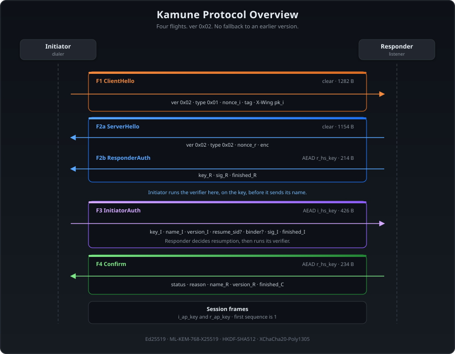

# Kamune

Communication over untrusted networks.

Kamune provides `Ed25519_MLKEM768_HKDF-SHA512_ChaCha20-Poly1305X` security
suite.

> [!NOTE]
> This is an experimental project. All suggestions and feedback are welcome and
> greatly appreciated.

## Features

- Message signing and verification using **Ed25519**
- Hybrid key establishment with **HPKE** export-only mode
  ([RFC 9180](https://www.rfc-editor.org/rfc/rfc9180)), over **ML-KEM-768**
  and X25519
- Ephemeral, quantum-resistant key encapsulation with **ML-KEM-768**, providing
  **Forward secrecy**.
- End-to-End, bidirectional symmetric encryption using **ChaCha20-Poly1305X**
- Key derivation via **HKDF-SHA512** (HMAC-based extract-and-expand)
- Lightweight, custom protocol implemented in both **TCP and UDP** for minimal
  overhead and latency
- **Real-time, instant messaging** over socket-based connection
- **Direct peer-to-peer communication**, with optional relay fallback
- **Protobuf** for fast, compact binary message encoding

## Modules

| Directory                    | Purpose                | Description                                                                                                                      |
| ---------------------------- | ---------------------- | -------------------------------------------------------------------------------------------------------------------------------- |
| `.` (root)                   | Core library           | Protocol, transport, cipher suite, session management, and storage abstraction                                                   |
| [`cmd/bus/`](cmd/bus/)       | Desktop GUI client     | Wails + Svelte desktop app with relay transport UI, session management, and encrypted history                                    |
| [`cmd/relay/`](cmd/relay/)   | Relay server           | Stateless blind relay that routes encrypted sessions between peers without decrypting traffic — supports WebSocket, TCP, and TLS |
| [`cmd/daemon/`](cmd/daemon/) | JSON-over-stdio daemon | Headless IPC wrapper for integrating kamune into external applications                                                           |
| [`cmd/tui/`](cmd/tui/)       | Terminal chat client   | Interactive Bubble Tea TUI with direct TCP, relay, peer verification (numeric fingerprint), and chat history browsing            |

## Roadmap

- [x] Application-level ping/pong keep-alive
- [x] Client-side minor version warning — surface the core warning to users in clients
- [x] Generate connection QR code in clients
- [x] NAT traversal / hole punching
- [x] Session resumption — reconnect without full re-handshake
- [ ] Chunked reads/writes for large messages
- [ ] Key rotation
- [ ] Custom encoding protocol (replace Protobuf)
- [ ] QUIC, WebRTC, or other transport protocols
- [ ] Messaging Layer Security (MLS) / group chats
- [ ] Android/iOS native applications

## How does it work?

A connection runs four flights:

1. **ClientHello.** The dialer sends a fresh hybrid public key (ML-KEM-768
   and X25519) and a nonce, in the clear.
2. **ServerHello and ResponderAuth.** The listener encapsulates to that key
   and proves its identity under the resulting handshake keys. The dialer's
   verifier accepts that key before the dialer sends its own identity.
3. **InitiatorAuth.** The dialer sends its identity, and may offer to resume
   a session. The listener checks the proof, decides whether to resume, and
   runs its verifier.
4. **Confirm.** The listener sends its name and version, and says whether
   the session resumed. Both sides then derive the session keys.

Later frames are signed, encrypted and sequenced. The first one is
sequence 1.

A later dial can resume the same session within 24 hours of the
refreshed time and within 7 days of the cold handshake. That time
moves on every successful handshake, and when a transport ends
without deleting state. Resumption runs the handshake again, with
new keys, and still runs the verifier (see
[SPEC §6.8](docs/SPEC.md#68-session-resumption)).

For the full specification, see [SPEC.md](docs/SPEC.md).

## Verifying a peer

Kamune checks that a peer holds the identity key it claims, but not whose
key it is. The application's verifier decides that, for example by asking the
user to compare a fingerprint of the key with the peer over another channel.
`pkg/fingerprint` computes these from the key's PKIX encoding, which both
peers see:

- `Numeric`: 40 digits in eight groups of five, from the SHA-512 of the key.
  It carries about 132.9 bits; this is the one to compare.
- `Emoji`: 8 emojis out of 96, from the SHA-256 of the key. About 52.7 bits is
  not enough on its own, since an attacker can search for a key that shows the
  same emojis.
- `Hex` and `Sum` (unpadded base64url of the SHA-256) are long to read out, and
  the hex form starts with the same 12 bytes for every Ed25519 key.
- `Pseudonym`: two adjectives, a noun and a number, about 29.6 bits. It is a
  nickname for display, not a fingerprint, and must not be used to verify a
  key.

Bus, the TUI and the daemon show two labelled numeric codes on a verify
prompt: yours and the peer's. Emoji and hex are not on that prompt. The
daemon's `verify_peer` event carries `own_code`, `peer_code` and
`safety_number`. An unpinned Auto-Accept dial sends its identity to any
key that answers.

See [SPEC §6.2.1](docs/SPEC.md#621-fingerprints).
