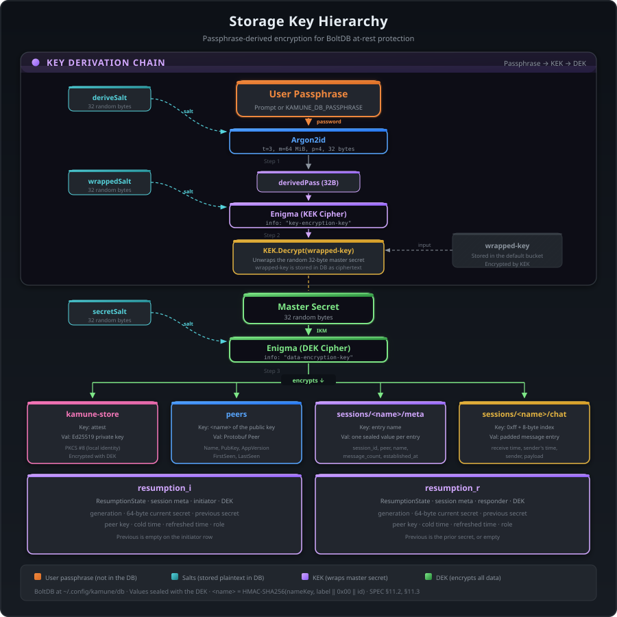

# Kamune Protocol Specification

**Version:** 0.9.0

**Status:** Experimental

**Suite:** `Ed25519_MLKEM768_HKDF-SHA512_ChaCha20-Poly1305X`

**Authors:** Kamune core team

---

## Table of Contents

1. [Overview](#1-overview)
2. [Terminology](#2-terminology)
3. [Cipher Suite](#3-cipher-suite)
4. [Wire Format](#4-wire-format)
   - 4.1 [Length-Prefixed Framing](#41-length-prefixed-framing)
   - 4.2 [Envelope Fields](#42-envelope-fields)
   - 4.3 [Encrypted Messages](#43-encrypted-messages)
5. [Routes](#5-routes)
   - 5.1 [Route Validation Rules](#51-route-validation-rules)
   - 5.2 [Session Data](#52-session-data)
6. [Protocol Flow](#6-protocol-flow)
   - 6.1 [Hellos](#61-hellos)
   - 6.2 [Authentication](#62-authentication)
   - 6.2.1 [Fingerprints](#621-fingerprints)
   - 6.3 [Confirm](#63-confirm)
   - 6.5 [Communication](#65-communication)
   - 6.6 [Session Teardown](#66-session-teardown)
   - 6.7 [Keep-Alive](#67-keep-alive)
   - 6.8 [Session Resumption](#68-session-resumption)
7. [Encryption and Key Derivation](#7-encryption-and-key-derivation)
   - 7.1 [Transcript](#71-transcript)
   - 7.2 [Hybrid KEM](#72-hybrid-kem)
   - 7.3 [Handshake secrets](#73-handshake-secrets)
   - 7.4 [Resumption inputs](#74-resumption-inputs)
   - 7.5 [Master and session secrets](#75-master-and-session-secrets)
   - 7.6 [Label table](#76-label-table)
   - 7.7 [Session AEAD construction](#77-session-aead-construction)
8. [Message Integrity and Replay Protection](#8-message-integrity-and-replay-protection)
   - 8.1 [Digital Signatures](#81-digital-signatures)
   - 8.2 [Sequence Numbers](#82-sequence-numbers)
   - 8.3 [AEAD Authentication](#83-aead-authentication)
   - 8.4 [Multi-Layer Integrity](#84-multi-layer-integrity)
9. [Transport Layer](#9-transport-layer)
   - 9.1 [TCP](#91-tcp)
   - 9.2 [UDP (via KCP)](#92-udp-via-kcp)
   - 9.3 [Relay](#93-relay)
   - 9.4 [Connection Contract](#94-connection-contract)
10. [Endpoint Roles](#10-endpoint-roles)
    - 10.1 [Responder Role](#101-responder-role)
    - 10.2 [Initiator Role](#102-initiator-role)
    - 10.3 [Role Summary](#103-role-summary)
11. [Storage and Persistence (Implementation Profile)](#11-storage-and-persistence-implementation-profile)
    - 11.1 [Database](#111-database)
    - 11.2 [Database Encryption](#112-database-encryption)
    - 11.3 [Stored Entities](#113-stored-entities)
    - 11.4 [Peer Expiration](#114-peer-expiration)
    - 11.5 [Upgrades and Deleted Data](#115-upgrades-and-deleted-data)
    - 11.6 [Sessions Without Persistence](#116-sessions-without-persistence)
12. [Security Properties](#12-security-properties)
    - 12.1 [Confidentiality](#121-confidentiality)
    - 12.2 [Integrity](#122-integrity)
    - 12.3 [Authentication](#123-authentication)
    - 12.4 [Forward Secrecy](#124-forward-secrecy)
    - 12.5 [Post-Quantum Resistance](#125-post-quantum-resistance)
    - 12.6 [Replay Protection](#126-replay-protection)
    - 12.7 [Traffic Analysis Resistance](#127-traffic-analysis-resistance)
13. [Constants and Limits](#13-constants-and-limits)
14. [Error Conditions](#14-error-conditions)
15. [Merged RFCs](#15-merged-rfcs)
16. [Appendix A: Key-schedule vector](#appendix-a-key-schedule-vector)

---

## 1. Overview

Kamune is a peer-to-peer communication protocol designed for secure, real-time
messaging over untrusted networks. It provides end-to-end encryption with
post-quantum resistance, forward secrecy, mutual authentication, and message
integrity.

Two peers establish a secured bidirectional channel with a four-flight
handshake (§6). The hellos are cleartext. The authentication flights are
encrypted under keys from a hybrid KEM. After that, session frames are
signed and encrypted (§6.5). A later connection can resume the same session
(§6.8). When the session ends, a close frame lets the peer tell a graceful
disconnect from a network failure (§6.6).

---

## 2. Terminology

| Term                     | Definition                                                                                                                                                                                                                         |
| ------------------------ | ---------------------------------------------------------------------------------------------------------------------------------------------------------------------------------------------------------------------------------- |
| **Initiator (Client)**   | The party that opens the connection and sends the ClientHello.                                                                                                                                                                    |
| **Responder (Server)**   | The party that accepts the connection and sends the ServerHello.                                                                                                                                                                  |
| **Attester**             | The cryptographic identity holder; signs with its private key.                                                                                                                                                                     |
| **Identifier**           | The verification counterpart of an Attester; verifies signatures with a public key.                                                                                                                                                |
| **Peer**                 | A remote party identified by its public key, name, and timestamps.                                                                                                                                                                 |
| **Transport**            | The encrypted, session-aware channel between two peers after the handshake.                                                                                                                                                        |
| **HPKE**                 | Hybrid Public Key Encryption (RFC 9180), used export-only with the MLKEM768-X25519 KEM and HKDF-SHA512. The export is the handshake shared secret (§7.2). HPKE does not carry later frames.                                        |
| **Enigma**               | The symmetric engine wrapping XChaCha20-Poly1305 with HKDF-SHA512 keys.                                                                                                                                                            |
| **Route**                | A typed tag on each session frame's metadata (§5). Handshake frames are not routed.                                                                                                                                                |
| **Fingerprint**          | A human-readable form of a public key. The verification code is the numeric form (§6.2.1).                                                                                                                                         |
| **Transcript**           | The SHA-512 of the tagged handshake entries (§7.1). Signatures, Finished MACs and the key schedule all bind to it.                                                                                                                 |
| **Verification code**    | The numeric fingerprint shown in a verify prompt. A prompt shows two labelled codes (§6.2.1).                                                                                                                                      |
| **Resumption secret**    | The 64-byte secret stored for one role of a session. The next handshake's binder and PSK are derived from it (§6.8, §7.4).                                                                                                         |
| **Resumption window**    | 24 hours from the last refresh, and 7 days from the last cold handshake (§6.8.5). The responder's values decide.                                                                                                                   |
| **Pin**                  | A peer key the dialer requires, or a peer constraint that has allowed the authenticated key (§6.2). The initiator sends its identity only after the pin matches or its verifier accepts.                                           |

---

## 3. Cipher Suite

Kamune provides one suite:
`Ed25519_MLKEM768_HKDF-SHA512_ChaCha20-Poly1305X`.

| Component                | Algorithm          | Purpose                                                                                        |
| ------------------------ | ------------------ | ---------------------------------------------------------------------------------------------- |
| **Identity signing**     | Ed25519            | Handshake signatures (§6.2) and the signature on each session frame (§8.1).                    |
| **Key establishment**    | ML-KEM-768-X25519  | Ephemeral X-Wing KEM. The shared secret is an HPKE export (§7.2). One key pair per handshake. |
| **Key derivation**       | HKDF-SHA512        | Handshake, session, exporter and resumption secrets (§7).                                      |
| **Handshake encryption** | XChaCha20-Poly1305 | Frames 0x03, 0x04 and 0x05, with associated data (§6.1).                                       |
| **Session encryption**   | XChaCha20-Poly1305 | Bidirectional session frames after Confirm (§7.7). No associated data.                         |

---

## 4. Wire Format

Handshake frames are the fixed layouts of §6.1. Session frames, after
Confirm, are the `SignedTransport` envelopes of §4.2, encrypted as in §4.3.

### 4.1 Length-Prefixed Framing

All messages are transmitted using a **length-prefixed framing** protocol over
the underlying transport. The protocol is transport-agnostic; see §9.4 for the
connection contract that any transport must satisfy:

```
+------------------+--------------------+
| Length (2 bytes)  | Payload (N bytes) |
+------------------+--------------------+
```

- **Length**: A 2-byte unsigned integer in **big-endian** byte order indicating
  the size of the payload in bytes.
- **Payload**: The serialized message, exactly `Length` bytes long.
- **Wire format maximum**: 65,535 bytes (uint16 max). The length prefix is a
  2-byte unsigned integer, so payloads larger than 65,535 bytes cannot be
  expressed on the wire.
- **Sender frame limit (`maxFrameSize`)**: 65,471 bytes, the wire format
  maximum less a 64-byte `transportReserve`. The reserve lets a transport wrap
  each frame again before it writes its own 2-byte length prefix; the relay
  transport (§9.3) adds 24 bytes to a frame of that size.
- **Protocol limit (`maxTransportSize`)**: A separate, smaller value that bounds
  the user-message size. Defined as `maxFrameSize` minus
  `reservedProtocolOverhead`. See §13 for current values.

Senders MUST NOT emit a payload larger than `maxFrameSize` and MUST reject a
user message whose encoded form would exceed `maxTransportSize`. Receivers MUST
accept any payload up to 65,535 bytes, and MUST read exactly `Length` bytes
before processing a frame. A truncated frame is invalid. Implementations over
byte streams MUST serialize complete frame writes; partial underlying writes
are an I/O concern and MUST be completed or treated as an error before another
frame is written.

### 4.2 Envelope Fields

Every session message is wrapped in a `SignedTransport` envelope. Handshake
frames are not.

```
SignedTransport {
  bytes Data      = 1;   // Serialized inner message
  bytes Signature = 2;   // Ed25519 signature (see §8.1)
  bytes Metadata  = 3;   // Pre-serialized Metadata (opaque; see below)
  bytes Padding   = 4;   // Random padding (bucketed; see §12.7)
}
```

| Field       | Type  | Role                                                                                                                                                                                                                                                                   |
| ----------- | ----- | ---------------------------------------------------------------------------------------------------------------------------------------------------------------------------------------------------------------------------------------------------------------------- |
| `Data`      | bytes | The serialized inner message (application data, or session data).                                                                                                                                                                                                      |
| `Signature` | bytes | Ed25519 signature over the domain-separated signing input (see §8.1), produced with the sender's identity private key.                                                                                                                                                 |
| `Metadata`  | bytes | Pre-serialized `Metadata` message (ID, timestamp, sequence, route), carried as opaque bytes. Serialized once by the sender; those same bytes are used both on the wire and as part of the signature input.                                                             |
| `Padding`   | bytes | Random bytes that pad the serialized envelope up to a bucketed target size (see §12.7). The field may appear more than once; the last occurrence is its value. Padding is not part of the signature input; encrypted session frames authenticate it with the AEAD tag. |

All message definitions in this document use Protocol Buffers proto3 binary
encoding. The `Metadata` field contains the raw proto3 encoding of a
`Metadata` message:

```
Metadata {
  string                    ID        = 1;
  google.protobuf.Timestamp Timestamp = 2;
  uint64                    Sequence  = 3;
  Route                     Route     = 4;
}
```

| Field       | Type      | Role                                                                                                                                         |
| ----------- | --------- | -------------------------------------------------------------------------------------------------------------------------------------------- |
| `ID`        | string    | Unique message identifier (random text).                                                                                                     |
| `Timestamp` | Timestamp | Sender's claimed send time (informational only — the receiver does not validate or trust this value; storage ordering uses the local clock). |
| `Sequence`  | uint64    | Monotonically increasing per-session send counter (see §8.2).                                                                                |
| `Route`     | `Route`   | Identifies the message's purpose and protocol phase (see §5).                                                                                |

### 4.3 Encrypted Messages

Once a session is established, the entire serialized `SignedTransport`
payload is encrypted before transmission:

```
Wire format for encrypted messages:
+------------------+--------------------------------------+
| Length (2 bytes)  | XChaCha20-Poly1305 Ciphertext       |
+------------------+--------------------------------------+

Ciphertext layout:
+-------------------+---------------------------+---------+
| Nonce (24 bytes)  | Encrypted SignedTransport | Tag     |
+-------------------+---------------------------+---------+
```

The 24-byte nonce is generated randomly for each encryption and prepended
to the ciphertext. The Poly1305 tag is appended by the AEAD. Session frames
use no associated data.

Handshake frames 0x03, 0x04 and 0x05 use the same XChaCha20-Poly1305
construction. Their associated data is `kamune/2 hs` followed by the version
and type bytes (§6.1). Frames 0x01 and 0x02 are not encrypted. The HPKE
operation inside the hellos is export-only (§7.2). It uses the RFC 9180
AEAD only inside the HPKE key schedule, and it does not wrap later frames.

---

## 5. Routes

Routes are typed tags on session frames. They are not used during the
handshake. The handshake is the four flights of §6.

```
enum Route {
  ROUTE_INVALID           = 0;
  reserved 1 to 6, 11, 12;
  ROUTE_EXCHANGE_MESSAGES = 7;
  ROUTE_CLOSE_TRANSPORT   = 8;
  ROUTE_PING              = 9;
  ROUTE_PONG              = 10;
  ROUTE_SESSION_DATA      = 13;
}
```

Numbers 1–6, 11 and 12 are reserved. A session frame that uses one MUST be
rejected.

| Value | Name                      | Direction     | Purpose                                |
| ----- | ------------------------- | ------------- | -------------------------------------- |
| `0`   | `ROUTE_INVALID`           | —             | Unset. MUST be rejected.               |
| `7`   | `ROUTE_EXCHANGE_MESSAGES` | Bidirectional | Application messages.                  |
| `8`   | `ROUTE_CLOSE_TRANSPORT`   | Bidirectional | Graceful session teardown (§6.6).      |
| `9`   | `ROUTE_PING`              | Bidirectional | Ping, with 8 random bytes.             |
| `10`  | `ROUTE_PONG`              | Bidirectional | Pong echoing the ping bytes.           |
| `13`  | `ROUTE_SESSION_DATA`      | Bidirectional | Session metadata (§5.2).               |

### 5.1 Route Validation Rules

Session routes MUST appear only after the session is established.

- Route `8` (`ROUTE_CLOSE_TRANSPORT`) is a graceful teardown. The receiver
  MUST close the connection, delete the session's resumption state (§6.6),
  and surface a peer-disconnected condition. It MUST NOT process a later
  frame on that connection.
- Route `13` (`ROUTE_SESSION_DATA`) carries session metadata. The payload is
  a `SessionData` message. The application handles the fields it knows and
  MUST ignore the rest.
- Routes `9` and `10` are keep-alives. The application answers `ROUTE_PING`
  with `ROUTE_PONG`. The transport delivers the frame to the caller.
- `ROUTE_INVALID` (`0`) and any other value MUST be rejected. A rejected
  route deletes resumption state (§6.6).

### 5.2 Session Data

Route `13` (`ROUTE_SESSION_DATA`) provides a generic, in-band mechanism for
peers to exchange session-level metadata. The payload is a `SessionData`
protobuf message:

```
SessionData {
  map<string, bytes> Fields = 1;
}
```

`Fields` is an open namespace. Peers send key-value pairs where the key is a
UTF-8 string and the value is opaque bytes. The application layer inspects known
keys and silently ignores any it does not recognize, allowing the protocol to
evolve without breaking backward compatibility.

#### Use Cases

**Relay token derivation.** After a session is established, peers may need
reconnection tokens for relay-based transports. Both peers generate an ephemeral
X25519 keypair, send the public key via `SessionData` with the key
`"ecdh_pubkey"`, and compute a shared secret via ECDH. A pool of 3 reconnection
tokens is derived from the shared secret using HKDF-Expand with the info prefix
`"kamune/relay-reconnect/v1/"`. The shared secret is never stored; only the
derived tokens are persisted. See `docs/RELAY.md` for details.

#### Design Constraints

- `ROUTE_SESSION_DATA` messages participate in the same sequence-number space
  as application messages. The sequence-number rules of §8.2 apply.
- Messages are encrypted and signed like any other session message.
- The route is bidirectional — either peer may send `SessionData` at any time
  after the session is established.
- The application MUST NOT block session teardown or error handling on
  unreceived `SessionData` fields.

---

## 6. Protocol Flow

A session is established in four flights. `ver` is `0x02`. There is no
fallback to an earlier version. Frames ride the length-prefixed connection
of §4.1. Integers are big-endian. The two cleartext hellos carry a fresh
hybrid-KEM contribution. Everything after them is encrypted under keys
derived from the transcript (§7).

```
Initiator                              Responder
F1  ClientHello (clear)            ->
                                   <-  F2a ServerHello (clear)
                                   <-  F2b ResponderAuth
    check the responder; run the verifier
F3  InitiatorAuth                  ->
                                       check the initiator; decide
                                       resumption; run the verifier
                                   <-  F4 Confirm
    check Confirm; derive session keys
```

The initiator's verifier runs after F2b and before F3. The responder's
verifier runs after F3 and before F4. Each side runs it once, on a cold
handshake and on a resumed one. On the initiator the verifier sees the
responder's authenticated key and not yet its name.

### 6.1 Hellos

Frame types:

| Type | Name          | Direction | Protection        | Size |
| ---- | ------------- | --------- | ----------------- | ---- |
| 0x01 | ClientHello   | I→R       | none              | 1282 |
| 0x02 | ServerHello   | R→I       | none              | 1154 |
| 0x03 | ResponderAuth | R→I       | AEAD, `r_hs_key`  | 214  |
| 0x04 | InitiatorAuth | I→R       | AEAD, `i_hs_key`  | 426  |
| 0x05 | Confirm       | R→I       | AEAD, `r_hs_key`  | 234  |

On every received frame, check in order: the exact length for the expected
type, `ver`, `type`, the AEAD open for an encrypted frame, then the
plaintext layout. A wrong `ver` is an unsupported-protocol error. Any other
failure of length, type or layout is an invalid-handshake error. An AEAD
failure is a verification failure. The connection closes with no reply.

**ClientHello** (1282 bytes):

| Offset | Size | Field |
| ------ | ---- | ----- |
| 0      | 1    | `ver` = 0x02 |
| 1      | 1    | `type` = 0x01 |
| 2      | 32   | `nonce_i`, random |
| 34     | 32   | `tag`, 32 random bytes. Reserved for a future contact-only mode. The responder ignores it. |
| 66     | 1216 | `pk_i`, the initiator's ephemeral X-Wing public key (ML-KEM-768 with X25519, HPKE KEM 0x647a) |

`pk_i` MUST parse as that KEM's public key.

**ServerHello** (1154 bytes):

| Offset | Size | Field |
| ------ | ---- | ----- |
| 0      | 1    | `ver` = 0x02 |
| 1      | 1    | `type` = 0x02 |
| 2      | 32   | `nonce_r`, random |
| 34     | 1120 | `enc`, the X-Wing encapsulation to `pk_i` |

The responder encapsulates to `pk_i` and the initiator decapsulates `enc`.
Both use HPKE export-only mode (§7.2). HPKE does not carry the later
frames. A low-order X25519 half of `pk_i` is a bad ClientHello: the
responder closes and returns an invalid-handshake error. A low-order
X25519 half of `enc` is a verification failure at the initiator, the same
as an AEAD failure. A corrupted ML-KEM half does not fail decapsulation; it
fails the AEAD open of frame 0x03.

An encrypted handshake frame is:

| Offset | Size   | Field |
| ------ | ------ | ----- |
| 0      | 1      | `ver` = 0x02 |
| 1      | 1      | `type` (0x03, 0x04 or 0x05) |
| 2      | 24     | XChaCha20-Poly1305 nonce, random |
| 26     | P + 16 | ciphertext and tag |

Associated data is the ASCII string `kamune/2 hs`, then `ver`, then `type`.
`P` is 172 (0x03), 384 (0x04) or 192 (0x05). The plaintext is a fixed
layout, not protobuf. Bytes after the last field up to `P` are padding and
MUST be zero; otherwise the frame is an invalid handshake. Each handshake
key seals at most two frames, so a random nonce is safe.

Common encodings:

- `key`: 44 bytes, an Ed25519 PKIX `SubjectPublicKeyInfo`. The first 12
  bytes MUST be `30 2a 30 05 06 03 2b 65 70 03 21 00`. The remaining 32
  MUST be a canonical Ed25519 public key, not a small-order point. One key
  has one encoding.
- `str8(max)`: a `u8` length, then that many bytes, with length at most
  `max`.

### 6.2 Authentication

**ResponderAuth** plaintext (`P` = 172, no spare padding):

| Offset | Size | Field | Transcript tag |
| ------ | ---- | ----- | -------------- |
| 0      | 44   | `key_R`, the responder identity | 0x10 |
| 44     | 64   | `sig_R` | 0x11 |
| 108    | 64   | `finished_R` | 0x12 |

**InitiatorAuth** plaintext (`P` = 384). The initiator identity block
(transcript tag 0x20) is, in order:

| Field | Encoding | Rule |
| ----- | -------- | ---- |
| `key_I` | `key` (44) | as above |
| `name_I` | `str8(64)` | a valid peer name; empty is allowed |
| `version_I` | `str8(32)` | 1 to 32 bytes that parse as a semver |
| `resume_sid` | `str8(24)` | length 0, or 24 characters of `[A-Z2-7]` |

Then `binder` (64 bytes, present if and only if `resume_sid` has length 24,
tag 0x21), `sig_I` (64, tag 0x22), `finished_I` (64, tag 0x23), and zero
padding.

Signatures, in the style of a TLS 1.3 CertificateVerify:

```
sig_R = Ed25519.Sign(sk_R,
            "kamune/2 responder signature" || 0x00 || TH_rid)
sig_I = Ed25519.Sign(sk_I,
            "kamune/2 initiator signature" || 0x00 || TH_ibind)
```

The two context strings differ, so one signature cannot be reflected as the
other. Each party signs its own identity together with both ephemeral
contributions. Finished MACs (§7.3) prove that the sender holds the KEM
secret for this transcript:

```
finished_R = HMAC-SHA512(r_fin_key, TH_rsig)
finished_I = HMAC-SHA512(i_fin_key, TH_isig)
finished_C = HMAC-SHA512(c_fin_key, TH_cbody)
```

Comparisons use a constant-time MAC compare. `finished_C` also proves that
the responder derived the same master secret, including a resumption PSK
when the session resumed, and it authenticates the responder's name and
version.

**Initiator, on F2b**, in this order. Any failure aborts with nothing sent:

1. `key_R` layout and a canonical public key. Otherwise invalid handshake.
2. `key_R` differs from the local key. Otherwise self-connection.
3. Pin. With a dial pinned to a key, or when a resumption is offered,
   `key_R` MUST equal that pin byte for byte. Otherwise peer-key mismatch.
4. `sig_R` verifies, then `finished_R`. A bad signature is a signature
   error. A bad Finished MAC is a verification failure.
5. If the connection implements a peer constraint, that constraint MUST
   allow `key_R`. Otherwise peer-key mismatch, and nothing has been sent.
   When the constraint ran and passed, the peer is pinned.
6. The verifier runs.

**Responder, on F3**, in this order:

1. Layout, a canonical `key_I`, a valid `name_I`, and a `version_I` that
   parses. A bad name is an invalid-name error. A bad version is an invalid
   handshake.
2. `key_I` differs from the local key. Otherwise self-connection.
3. `sig_I` verifies, then `finished_I`. From here the initiator is
   authenticated (§10.1).
4. If the connection implements a peer constraint, that constraint MUST
   allow `key_I`. Otherwise close with no Confirm and return peer-key
   mismatch. When it ran and passed, the responder's verify request is
   pinned.
5. Compare versions. On a mismatch send `Confirm` with status REJECTED and
   reason VERSION, and return a version-mismatch error.
6. The resumption decision (§6.8.3), then the verifier.

The verifier sees only an authenticated peer. The session can still fail
afterwards, so an application stores the peer after the handshake returns,
from the remote peer the transport reports. That record carries the name
and version on both sides. The library does not store peers.

A nil verifier error accepts. The verify context carries the verify
deadline and is cancelled when the server closes or the dial context ends.
A nil error returned after that context is done is a rejection. A late
accept is a rejection.

The verifier request carries the role, whether the peer was pinned,
whether the initiator will offer resumption, whether the responder has
accepted an offer, and the session id in those two cases. On the initiator
the peer's name and version are empty: the responder sends them only after
it has accepted the initiator.

Clients apply this policy. The library does not:

| Mode | Initiator | Responder |
| ---- | --------- | --------- |
| Strict | Prompt, except when the peer is pinned and resumption was offered. The key cannot change on that offer. | Prompt on every handshake. A resumed session shows that it is reconnecting. |
| Quick | Accept when pinned. Otherwise prompt. When the unpinned key is a stored peer, the prompt names that stored peer. | Accept when the session resumed, when the peer is pinned, or when the key is a stored, unexpired peer. Otherwise prompt. |
| Auto-Accept | Accept. An unpinned dialer of this mode reveals its identity to any key (§12.3). | Accept. |

A Strict initiator that pinned the peer and offered resumption is not
prompted on that handshake, even when the offer comes back cold. The
key is the one already approved. The cold result is a new session
(§6.8.4).

### 6.2.1 Fingerprints

A verify prompt shows two labelled lines. Each line is the numeric
fingerprint of one PKIX key: eight groups of five digits, about 132.9 bits,
SHA-512 over the key.

```
Your code:      12345 67890 12345 67890 12345 67890 12345 67890
<peer>'s code:  09876 54321 09876 54321 09876 54321 09876 54321
Read your code to your contact and have them read theirs. Every digit
of both codes must match.
```

The lines are labelled, not sorted, so each user checks the other's code
against what the other reads from their own device. An attacker in the
middle needs a second preimage of a 40-digit code.

The safety number is the two numeric fingerprints, the bytewise-smaller
key first, joined by a newline. Both peers compute the same string. It is
for copy and paste, not for reading aloud.

Emoji, hex and base64 forms are not verification codes. A pseudonym is a
display nickname. A prompt that shows one labels it as a nickname, and
shows a self-asserted name only as a name the peer gives itself, outside
the code area. The initiator's prompt shows no unauthenticated responder
name.

### 6.3 Confirm

**Confirm** plaintext (`P` = 192). The body is transcript tag 0x30:

| Field | Encoding | Rule |
| ----- | -------- | ---- |
| `status` | u8 | 1 COLD, 2 RESUMED, 3 REJECTED. Any other value is an invalid handshake. |
| `reason` | u8 | 0 with COLD or RESUMED. With REJECTED: 1 VERIFIER, 2 VERSION. |
| `name_R` | `str8(64)` | empty with REJECTED; otherwise a valid peer name |
| `version_R` | `str8(32)` | empty with REJECTED; otherwise 1 to 32 bytes that parse as a semver |

Then `finished_C` (64 bytes, tag 0x31) and zero padding.

**Initiator, on F4:**

1. Layout, then `finished_C`. A bad MAC is a verification failure.
2. REJECTED with reason VERIFIER is a handshake rejection. REJECTED with
   reason VERSION is a handshake rejection that wraps a version mismatch.
3. RESUMED when no offer was sent is an invalid handshake.
4. Validate `name_R`, then compare versions. A mismatch closes the
   connection and returns a version-mismatch error. The responder has
   already established and sees the connection drop. Both sides use the
   same version rule, so this happens only when a responder skips its own
   check.

On REJECTED the initiator derives the master secret with a zero PSK only
far enough to check `finished_C`. It derives nothing after that.

The session id is never sent in the clear. It appears only inside frame
0x04, and only as a resumption offer. A cold session id is the first 15
bytes of the `session id` derived secret, encoded with unpadded base32:
24 characters of `[A-Z2-7]` (120 bits). A resumed session keeps the offered
id.

The first session frame is sequence 1 (§6.5). No handshake frame uses the
session sequence space.

### 6.5 Communication

Once the session is established, peers exchange application messages on
the transport.

**Sending a message:**

1. The sender increments its send counter. The counter starts at 0, so the
   first session frame is sequence 1.
2. The application message is serialized (`Data`).
3. `Metadata` is assembled (`ID`, `Timestamp`, `Sequence`, `Route`) and
   serialized once to `MetadataBytes`.
4. The signature is computed over the domain-separated signing input
   (§8.1) covering `MetadataBytes` and `Data`, using the sender's identity
   key.
5. The signature, `Data`, `MetadataBytes` and random padding are assembled
   into a `SignedTransport` envelope. `MetadataBytes` is placed into the
   `Metadata` field as-is.
6. The envelope is serialized.
7. The bytes are encrypted with the sender's outbound cipher
   (XChaCha20-Poly1305, a fresh 24-byte nonce, no associated data).
8. The ciphertext is written with length-prefixed framing.

The initiator's outbound key is `i_ap_key` and its inbound key is
`r_ap_key`. The responder uses the reverse (§7.5).

**Receiving a message:**

1. Read the length prefix and the full ciphertext.
2. Decrypt with the inbound cipher. An AEAD failure ends the connection
   and keeps resumption state (§6.6).
3. Deserialize a `SignedTransport` envelope.
4. Verify the signature over the raw `Metadata` bytes and `Data` (§8.1).
5. Only after the signature verifies is `Metadata` decoded.
6. The sequence number MUST equal the last received sequence plus 1.
   A duplicate or a gap ends the connection and keeps resumption state
   (§6.6).
7. Update the receive counter.
8. Deserialize the inner message.
9. Check the route (§5.1). A route that is not allowed ends the connection
   and deletes resumption state. Return the route and metadata to the
   application.

A receiver that allows concurrent receive calls on one session MUST
complete steps 1 to 7 for one frame before it reads the next, so frames
are checked in wire order. The reference implementation serves such calls
one at a time, and each frame goes to exactly one caller.

### 6.6 Session Teardown

Resumption state is deleted only for an end that the authenticated peer or
the local user caused. A path that can drop, replay or corrupt a frame
does not delete it.

| Event | Who can cause it | State |
| ----- | ---------------- | ----- |
| Local close of the session | local user | delete |
| Received `ROUTE_CLOSE_TRANSPORT` (AEAD and signature valid, in sequence) | the peer | delete |
| AEAD-valid frame whose signature fails, or whose route is not allowed | a holder of the traffic key | delete, and end the connection |
| AEAD failure | anyone on the path | end the connection, keep, and touch the idle window (§6.8.5) |
| Duplicate sequence or a gap | anyone on the path, including a relay that drops one frame | end the connection, keep, and touch |
| Connection drop, or a local abort that does not end the session | network or local | keep, and touch |

Touch updates the idle timestamp of §6.8.5 only when the stored generation
is still the one this transport committed. A stale transport whose session
was resumed elsewhere leaves the newer row alone.

**Graceful close.** The peer sends `ROUTE_CLOSE_TRANSPORT` with an empty
payload, as a normal session frame, then closes the connection. The
reference implementation waits at most 5 seconds for that write. The
receiver closes, surfaces a peer-disconnected condition, and every later
receive returns the same condition. Sends then fail as connection-closed.
The application does not need to close the transport again.

A drop with no close frame surfaces a connection-closed condition. The
two are distinct: peer disconnected means a graceful close; connection
closed means the path ended.

The close is best-effort. If it is not written, the peer sees a drop. The
sender has already deleted its resumption state, so the peer cannot resume.

To drop a connection and keep the session resumable, an implementation
closes without `ROUTE_CLOSE_TRANSPORT` and leaves the row in place. The
reference implementation offers an abort close for this. The ordinary
close ends the session.

### 6.7 Keep-Alive

Peers may probe liveness with an application-level ping/pong on routes 9
and 10. Those frames use the same sequence space and encryption as other
session frames. The transport treats them as ordinary frames.

**Ping:**

1. The caller generates 8 random bytes.
2. It sends them with `ROUTE_PING`.
3. It waits for a response on an application-owned channel, with a timeout.
4. The application's receive loop dispatches `ROUTE_PONG` to that channel.
5. The route MUST be `ROUTE_PONG` and the echoed data MUST match.
6. A mismatch or a timeout fails the ping.

The receive loop MUST answer `ROUTE_PING` by sending the same bytes with
`ROUTE_PONG`.

### 6.8 Session Resumption

Resumption lets two peers continue a session on a new connection. The old
transport is gone: new handshake, new keys, sequence numbers from 1. The
session id stays, and the message log stays in the same storage bucket.
The verifier still runs (§6.2).

Only an initiator row may be offered, and only a responder row may be
accepted. That stops one party from resuming as the other.

#### 6.8.1 Stored state

Each role has its own row in the session's metadata, under `resumption_i`
(initiator) or `resumption_r` (responder). A value left under an older key
is ignored. The row holds:

| Field | Meaning |
| ----- | ------- |
| Generation | Local counter, at least 1. Not sent. |
| Current | 64-byte resumption secret. |
| Previous | 64 bytes, or empty. Responder only. The secret the last accepted offer used. |
| Peer public key | PKIX key authenticated for this session. |
| Cold time | Time of the last cold handshake of this session. |
| Refreshed time | Time of the last handshake, or of the last transport end that kept state. |
| Role | Must match the meta key the row is stored under. |

`established_at` is a separate meta value, written on every cold
establishment. The peer key meta stays as well.

#### 6.8.2 Offer

A dial that offers resumption:

1. Fails at construction when the store has no initiator row for the
   session id, and when it is combined with persistence off.
2. Takes the resume lock (§6.8.4) or returns resume-in-progress. It reads
   the row again. No row: no resumption state. A pin that differs from the
   stored peer key: peer-key mismatch. If that peer is deleted or expired,
   the row is deleted and the dial returns no resumption state.
3. Pins `key_R` to the stored peer key, sends `resume_sid`, and sends
   `binder = HMAC-SHA512(binder_key, TH_iid)` where `binder_key` is derived
   from `Current` (§7.4). There is no local window check. The responder
   decides. An expired offer costs the responder one HMAC.

A dial may require that the offer be accepted. If the answer is COLD, the
initiator closes, returns resume-refused, and keeps its row. A session
that does resume under that option is authenticated by the PSK as well as
by the signatures (§12.5). No client sets this by default.

#### 6.8.3 Decision

Only after `sig_I` and `finished_I` verify, the responder reads the
responder row for `resume_sid`, if an offer is present:

```
okCurrent  = a row exists and the binder matches Current
okPrevious = a row exists, Previous is 64 bytes,
             and the binder matches Previous
peerStored = the initiator key is a stored, unexpired peer

resumed = an offer is present
      and resumption is enabled and persistence is on
      and the row exists with the responder role
      and the row's peer key equals key_I
      and peerStored
      and the idle window and the maximum age both hold (§6.8.5)
      and (okCurrent or okPrevious)
```

The secret used is `Current` when that matched, otherwise `Previous`.
When `resumed` is false, for any reason, the handshake continues as a
cold one and the Confirm says COLD. There is no separate rejection for a
bad binder, an unknown session, a deleted peer or an expired window.
Deleting a peer, or letting it expire, stops resumption. A session whose
peer was never stored cannot be resumed.

#### 6.8.4 Commit

The responder commits before it sends Confirm. The initiator commits only
after `finished_C` verifies.

| Event | Responder | Initiator |
| ----- | --------- | --------- |
| Cold established | Write generation 1: `Current` is the new secret, `Previous` empty, peer `key_I`, both times now, responder role. | Write generation 1: `Current` is the new secret, peer `key_R`, both times now, initiator role. |
| Resumed | Replace the row. Generation becomes one more than the generation read. `Current` is the new secret. `Previous` is the secret the binder matched. Refresh time is now. Cold time and the peer key are copied. | Same, without `Previous`. Generation becomes one more than the generation it read. |
| Offer answered COLD | Nothing for the old id. | Delete the old initiator row, then write the cold row. Not when the dial required resumption: that dial keeps the old row and does not establish. |
| Verifier rejects a resumed peer | Delete the responder row at the generation read. | Delete the initiator row when Confirm is REJECTED. |
| Initiator compare-and-swap conflict | — | Read the row again and delete it at the generation just read, so the next dial is a clean cold handshake. |

The write replaces the whole record and fails if the stored generation is
no longer the one the caller read. A storage error other than that
conflict is logged. The responder still sends Confirm, and the session is
not resumable. A conflict on the responder closes without Confirm.

This cannot desynchronize while one initiator resumes the session at a
time:

- Confirm never sent: if the responder committed, the initiator's
  `Current` is the responder's `Previous`. If not, nothing changed.
- Confirm sent but lost: the responder holds the new secret and the one
  the offer used. The initiator still holds the one it offered. The next
  offer matches `Previous`.
- Confirm received: both hold the new secret.

**Resume lock.** The initiator locks `(store, session id)` before it reads
its row and holds the lock until it commits or fails. A second dial of the
same session returns resume-in-progress at once. One process owns a store
file, so the in-process lock covers the real case. The responder's
compare-and-swap is the backstop against a copied store.

**Previous.** A secret stolen from storage stays usable for one extra
resume. Every resume still needs the identity key and a fresh KEM.

#### 6.8.5 Window

The responder's clock decides. The initiator does not pre-check.

- Idle limit: 24 hours from the refreshed time. That time moves on every
  successful handshake of the session, and when a transport ends without
  deleting state (§6.6). A session that stayed up for days and then
  dropped can resume within 24 hours of the drop.
- Maximum age: 7 days from the cold time. Resumes and touches do not move
  it.

A crash leaves the refreshed time at the last handshake, which only
shortens the window. Both limits are constants.

#### 6.8.6 Persistence off

- A server with persistence off writes no resumption state and never
  accepts an offer.
- A dialer with persistence off writes no state. Combining it with an
  offer is an error at construction.
- Resumption can be disabled for every peer of a server. Every offer is
  then answered COLD. Deleting one peer stops resumption for that peer
  only (§6.8.3). Disabling resumption does not skip the verifier.

#### 6.8.7 Sweep

A sweep at time `now` runs in one storage transaction:

1. Delete every `resumption_i` and `resumption_r` row whose refreshed time
   is more than the idle limit ago, or whose cold time is more than the
   maximum age ago.
2. Delete every session namespace that then has no resumption row, an
   empty chat namespace, no session name, and an `established_at` older
   than the maximum age (or no `established_at`). Named sessions and
   sessions with messages stay.

A server with persistence runs the sweep when it starts and every hour
after, until it closes. A dial-only application may call it. The sweep
bounds the rows an Auto-Accept listener keeps when Confirm is dropped.

---


## 7. Encryption and Key Derivation

All key-schedule functions use HKDF-SHA512 (hash length 64).

```
Expand-Label(S, label, ctx, L) =
    HKDF-Expand(S,
        uint16_be(L) || uint8(len(full)) || full
        || uint8(len(ctx)) || ctx,
        L)
    where full = "kamune2 " || label
    len(full) <= 255 and len(ctx) <= 255

Derive-Secret(S, label, TH) = Expand-Label(S, label, TH, 64)
zeros = 64 zero bytes
```

### 7.1 Transcript

```
TH(entries) = SHA-512("kamune/2 transcript" || entry_1 || ... || entry_n)
entry       = uint8(tag) || uint32_be(len(bytes)) || bytes
```

| Tag | Bytes | Name of TH after it |
| --- | ----- | -------------------- |
| 0x01 | ClientHello, all 1282 bytes | `TH_ch` |
| 0x02 | ServerHello, all 1154 bytes | `TH_sh` |
| 0x10 | `key_R` (44 bytes) | `TH_rid` |
| 0x11 | `sig_R` | `TH_rsig` |
| 0x12 | `finished_R` | `TH_rfin` |
| 0x20 | initiator identity block | `TH_iid` |
| 0x21 | `binder`, only when present | `TH_ibind` |
| 0x22 | `sig_I` | `TH_isig` |
| 0x23 | `finished_I` | `TH_ifin` |
| 0x30 | Confirm body | `TH_cbody` |
| 0x31 | `finished_C` | `TH_final` |

Padding and AEAD framing are not hashed. The AEAD covers them, and the
padding must be zero. When no binder is present, `TH_ibind` equals
`TH_iid`. The layouts are canonical, so the hashed bytes and the parsed
values correspond one to one.

### 7.2 Hybrid KEM

```
info = "kamune/2 kex"
ss   = Export("kamune/2 kex secret", 64)
```

The responder opens an HPKE export-only sender to `pk_i` (HKDF-SHA512) and
the initiator opens the recipient on `enc` with the same info. `ss` is the
64-byte export. It combines ML-KEM-768 and X25519 through the HPKE key
schedule. Appendix A records one encapsulation.

### 7.3 Handshake secrets

```
hs        = HKDF-Extract(salt = zeros, IKM = ss)
r_hs      = Derive-Secret(hs, "r hs traffic", TH_sh)
i_hs      = Derive-Secret(hs, "i hs traffic", TH_sh)
r_hs_key  = Expand-Label(r_hs, "key", "", 32)    // frames 0x03 and 0x05
i_hs_key  = Expand-Label(i_hs, "key", "", 32)    // frame 0x04
r_fin_key = Expand-Label(r_hs, "finished", "", 64)
i_fin_key = Expand-Label(i_hs, "finished", "", 64)
```

### 7.4 Resumption inputs

Only when F3 carries an offer. `res` is the stored 64-byte resumption
secret (§6.8.1).

```
binder_key = Expand-Label(res, "res binder", "", 64)
binder     = HMAC-SHA512(binder_key, TH_iid)
psk        = Expand-Label(res, "res psk", "", 64)
```

### 7.5 Master and session secrets

```
psk_in     = psk if status is RESUMED, else zeros
master     = HKDF-Extract(
                 salt = Expand-Label(hs, "derived", "", 64),
                 IKM  = psk_in)
c_fin_key  = Expand-Label(master, "r confirm", "", 64)

// after TH_final:
i_ap       = Derive-Secret(master, "i ap traffic", TH_final)
r_ap       = Derive-Secret(master, "r ap traffic", TH_final)
i_ap_key   = Expand-Label(i_ap, "key", "", 32)  // initiator to responder
r_ap_key   = Expand-Label(r_ap, "key", "", 32)  // responder to initiator
exp_master = Derive-Secret(master, "exp master", TH_final)
res_next   = Derive-Secret(master, "res master", TH_final)
sid_bytes  = Derive-Secret(master, "session id", TH_final)[0:15]
```

On REJECTED the initiator derives `master` with a zero PSK only to check
`finished_C`.

**Exporter.** After `TH_final`:

```
ExportKeyingMaterial(label, context, L) =
    Expand-Label(
        Expand-Label(exp_master, label, "", 64),
        "exporter", SHA-512(context), L)
```

The inner call uses an empty context. `label` MUST be 1 to 200 bytes and
`L` MUST be 1 to 16320 (255 × 64); otherwise the call is an invalid
export. A nil context and an empty context are the same. The exporter
secret is wiped when the transport ends. After close, abort or any other
end, the call fails as connection-closed.

### 7.6 Label table

Through Expand-Label, with the prefix `kamune2 `: `r hs traffic`,
`i hs traffic`, `key`, `finished`, `derived`, `res binder`, `res psk`,
`r confirm`, `i ap traffic`, `r ap traffic`, `exp master`, `res master`,
`session id`, `exporter`, and the exporter labels that callers supply.

Outside Expand-Label: `kamune/2 transcript` (§7.1), `kamune/2 kex` and
`kamune/2 kex secret` (§7.2), `kamune/2 hs` (§6.1), and the signature
contexts of §8.1. A future contact-only mode would add the salt
`kamune/2 contact tag`. No domain string is used for two purposes. Short
labels such as `key` and `derived` appear only under different secrets.

### 7.7 Session AEAD construction

Each directional session key is used with XChaCha20-Poly1305. For every
encryption the sender generates a fresh 24-byte random nonce and emits
`nonce || ciphertext || tag`. The receiver takes the first 24 bytes as the
nonce. Session frames use no associated data. Handshake frames do (§6.1).

---


## 8. Message Integrity and Replay Protection

### 8.1 Digital Signatures

Handshake signatures use two contexts (§6.2):

```
"kamune/2 responder signature" || 0x00 || TH_rid
"kamune/2 initiator signature" || 0x00 || TH_ibind
```

Session frames use a third context. Every `SignedTransport` message includes
a digital signature over the domain-separated signing input:

```
SigningInput = "kamune/transport-sign/v1" || varint(len(MetadataBytes)) || MetadataBytes || Data
```

Where `MetadataBytes` is the raw bytes of the `Metadata` field (pre-serialized
by the sender), and `Data` is the serialized inner message. The `varint` is an
unsigned base-128 variable-length integer encoding the byte length of
`MetadataBytes`. The signature is computed using the sender's long-term identity
key (Ed25519). The receiver verifies it with the public key authenticated
in this handshake (§6.2).

An implementation that signs with an identity key registers every context
string, and no registered context is a prefix of another. The three
contexts above are the ones this specification uses.

This provides:

- **Authentication**: Proof that the message was created by the claimed sender.
- **Integrity**: Any modification to `Metadata` or `Data` invalidates the
  signature.
- **Non-repudiation**: The sender cannot deny having sent the message (though
  this is a peer-to-peer context, so non-repudiation is limited to the two
  parties).

### 8.2 Sequence Numbers

Each `Transport` maintains two monotonically increasing 64-bit unsigned
counters:

- A **send counter**: Incremented before each outgoing message. The first
  message has sequence `1`.
- A **receive counter**: Tracks the last received sequence number. Starts at
  `0`.

**Validation rules on receive:**

| Condition                    | Action                                                                    |
| ---------------------------- | ------------------------------------------------------------------------- |
| `seq == receive counter + 1` | Accept; update the receive counter.                                       |
| `seq < receive counter + 1`  | Reject as **duplicate**. End the connection, keep resumption state, and touch its window (§6.6). |
| `seq > receive counter + 1`  | Reject as **gap**. End the connection, keep resumption state, and touch its window (§6.6). |

Sequence numbers provide ordering guarantees and replay protection within a
session.

### 8.3 AEAD Authentication

The XChaCha20-Poly1305 AEAD cipher provides ciphertext authentication. Any
tampering with the encrypted payload (including the nonce) will cause
decryption to fail, ensuring that only the holder of the derived symmetric key
can produce valid cipher texts.

### 8.4 Multi-Layer Integrity

Kamune employs defense-in-depth with three independent integrity mechanisms:

1. **AEAD tag** (Poly1305): Authenticates the ciphertext at the encryption
   layer.
2. **Digital signature** (Ed25519): Authenticates the plaintext message and
   its metadata (ID, timestamp, sequence, route) at the signing layer using a
   domain-separated signing input (see §8.1).
3. **Sequence number**: Provides ordering and replay protection at the session
   layer.

---

## 9. Transport Layer

The transport layer carries the length-prefixed frames of §4.1 between the two
endpoints of a session. Kamune supports several transport backends out of the
box and is open to others through the connection contract of §9.4.

### 9.1 TCP

TCP is the default transport. It provides the reliable, ordered byte-stream
delivery the protocol assumes, and the length-prefixed framing of §4.1 operates
directly over the TCP stream.

### 9.2 UDP (via KCP)

For environments where TCP is unavailable or undesirable, kamune supports
UDP-based transport using KCP, which provides reliable, ordered delivery over
UDP. The same framing and protocol messages are used identically over KCP.

KCP provides ARQ for reliability and congestion control. The reference
implementation does not enable kcp-go's Reed-Solomon forward error correction
(it uses no data or parity shards) or its packet encryption, so lost packets
are recovered only by retransmission. Kamune encrypts and authenticates its own
frames, but KCP packets are not authenticated: a sender that forges a peer's
source address can make the listener start a KCP session, or close the
listener's session with that peer.

### 9.3 Relay

For NAT traversal or peers that cannot reach each other directly, kamune ships a
relay transport. The relay is a blind, stateless, token-based session switch: a
listener connects, receives a short random token, and shares it out of band; the
dialer connects with the same token. End-to-end authentication and encryption
are unchanged from §6; the relay only forwards encrypted frames.

See [`docs/RELAY.md`](RELAY.md) for the wire format, threat model, and
operational details.

### 9.4 Connection Contract

Every transport — TCP, UDP/KCP, relay, or a custom backend — exposes the same
minimal interface to the protocol:

```
interface Conn {
    ReadBytes() -> (bytes, error)
    WriteBytes(data: bytes) -> error
    SetDeadline(deadline: Timestamp) -> error
    Close() -> error
}
```

Where:

- **`ReadBytes`**: Reads a single length-prefixed frame. Reads the 2-byte
  big-endian length prefix, then exactly that many payload bytes. Returns the
  payload, or an error if the read fails or the frame is truncated. Successful
  reads MUST be reliable, in wire order, and free of duplicate frames. A read
  that fails before any byte of the frame has arrived, for example because its
  deadline passed, leaves the stream intact. A read that fails after part of
  the frame has been consumed MUST close the connection and report it as
  closed: the consumed bytes cannot be put back, so a later read would start
  inside the frame.
- **`WriteBytes`**: Writes a single length-prefixed frame. Prepends a 2-byte
  big-endian length prefix and writes the full payload atomically (retrying on
  partial writes). Returns an error if the write fails. A write that fails
  after part of the frame has been written MUST close the connection and
  report it as closed, since the peer would read a retried frame as the rest
  of the partial one.
- **`SetDeadline`**: Sets an absolute time bound for subsequent `ReadBytes` and
  `WriteBytes` operations. Passing a zero value clears the deadline.
- **`Close`**: Releases the underlying transport. Subsequent calls return an
  error.

The contract is the only requirement the protocol imposes. A conforming
implementation MUST serialize its outbound session messages so that their wire
order is the same as their sequence-number order. It MUST deliver inbound
frames reliably and in that wire order, without duplicates. Sending and
receiving may otherwise proceed concurrently.

Kamune hands a `Conn` frames of at most `maxFrameSize` (65,471 bytes, §4.1),
and a `Conn` MUST carry every frame up to that size. A transport that wraps
each frame, such as the relay, may add up to `transportReserve` (64 bytes) and
still fit the 2-byte length prefix.

An implementation may additionally expose the underlying connection object (for
example, a `net.Conn` in environments that provide one) for callers that need
transport-specific metadata.

This contract is also the plug-in point for custom transports. The transport
layer exposes a Listener (accepts incoming connections and yields `Conn` values)
and a Dial function (opens outgoing connections and returns a `Conn`). Any
backend that can express itself in those two shapes is a valid kamune transport.

The contract has no channel binding. End-to-end signatures over a transcript
that already contains the fresh KEM defeat a path-layer man in the middle.
A binding to the underlying path is not an input to the transcript.

---

## 10. Endpoint Roles

This section describes endpoint roles, not a required programming interface.
An implementation MAY use different names or expose different APIs.

### 10.1 Responder Role

A server listens for connections and, for each one, runs the responder side
of §6.

Per connection:

1. Wait for a ClientHello. The waiting stage allows `introTimeout` (10
   seconds) for a valid hello.
2. On a valid ClientHello, enter the hello stage, then encapsulate and
   send ServerHello and ResponderAuth.
3. Receive InitiatorAuth. Once `sig_I` and `finished_I` verify, the
   connection is authenticated.
4. Decide resumption (§6.8.3) and run the verifier.
5. Commit resumption state, send Confirm, and hand the transport to the
   session handler.

The hello-stage deadline is the handshake timeout plus the verify timeout
(30 s + 150 s). The initiator's user may be comparing codes. After the
responder's own verifier, the same sum bounds the rest of the handshake.

**Admission.** A connection is not immune to eviction until it has proved
possession of its key over this transcript.

| Stage | Entered | Bound | Eviction | Deadline |
| ----- | ------- | ----- | -------- | -------- |
| waiting | accept | 256 connections | oldest connection in a network that has the most waiting connections | 10 s to a valid ClientHello |
| hello | valid ClientHello, before encapsulation | 256, a separate list | same rule, among hello connections only | 180 s |
| authenticated | `sig_I` and `finished_I` verified | 16 per source, for connections that have a source | not evictable | the verifier's limit, then the handshake timeout |

A flood of ClientHellos can evict only other hello-stage connections, and
the drop picks from the networks with the most entries, so a flood from a
few networks mostly evicts itself. A dialer in the hello stage does not
compete with connections that have not sent a ClientHello.

The per-source cap is counted at accept for a source that cannot be forged.
A source that can be forged is counted when the connection becomes
authenticated. Relay-accepted connections have no source: one registration
yields one connection. Each hello-stage connection costs the listener one
encapsulation, one signature, a goroutine and a few kilobytes, bounded by
256 plus any per-source rate the server applies before admission.

Closing the server closes connections still in the handshake. A handshake
that finishes after that is closed instead of being handed to the handler.
A cold one leaves no session in storage. Sessions already handed off are
not affected. Shutdown closes the server the same way and then waits for
those handshakes and handlers. If its context ends first, it returns, and
work still running finishes on its own.

Logging treats a failure before authentication as a debug event, and a
failure after it as an error.

### 10.2 Initiator Role

A dialer opens a connection and runs the initiator side of §6.

1. Open the connection. The default is TCP. A custom dial may supply
   UDP/KCP, a relay, or any transport that meets §9.4. A dial context
   cancels the handshake: the connection closes when the context ends.
2. If offering resumption, take the resume lock (§6.8.4).
3. Send ClientHello. Receive ServerHello and ResponderAuth.
4. Apply the pin, check the signature and Finished MAC, and run the
   verifier. A rejection sends nothing further.
5. Send InitiatorAuth. The deadline for Confirm is the handshake timeout
   plus the verify timeout, because the responder may be prompting.
6. Check Confirm, commit resumption state, release the lock, and return
   the transport.

A dial that offers resumption and requires it to succeed closes without
establishing when the answer is cold (§6.8.2).

Common limits: dial timeout 10 seconds, handshake timeout 30 seconds,
verify timeout 150 seconds. A responder that never sends ResponderAuth
fails the dial within the handshake timeout. One that prompts can hold
the dial for the handshake timeout plus the verify timeout.

### 10.3 Role Summary

| Role | Behaviour |
| ---- | --------- |
| **Server** | Listens, runs the responder handshake, hands the transport to a handler. |
| **Dialer** | Opens a connection, runs the initiator handshake, returns the transport. |
| **Transport** | Encrypted, session-aware channel once the handshake has finished. |
| **Connection** | The framed byte pipe under the protocol (§9.4). |

---


## 11. Storage and Persistence (Implementation Profile)

This section is non-normative. It describes the reference implementation's
local persistence profile and is not required for protocol interoperability.

<picture>
  
</picture>

The diagram does not show the resumption rows. Each session's `meta` bucket
holds `resumption_i` and `resumption_r` (§11.3).

### 11.1 Database

The reference implementation persists its state in an embedded key-value store located at
`~/.config/kamune/db` by default. The location is overridable via the
`KAMUNE_DB_PATH` environment variable.

A missing database directory is created with mode 0700, and the default
`~/.config/kamune` directory is restricted to 0700 on every open; a directory
chosen by the caller is left as it is. The database file is created with mode
0600, and every open removes group and other permission bits from it, logging
a warning, or fails when it cannot. These modes are not applied on Windows.

Symbolic links in the database path are resolved when the database is opened.
While the database is open, the implementation holds an exclusive lock on a
file next to it, named after the database with a `.lock` suffix (mode 0600).
Other opens of the same database wait for that lock, up to the open timeout
(5 seconds by default). The lock file is never deleted; tools that copy or
clean up the database directory should leave it in place while a client runs.
Releases up to v0.6.0 do not take this lock, so such a client must not open the
database while a newer one may rewrite it.

Some operations rewrite the whole database file: the key upgrades described in
§11.2, a passphrase change, and compaction (§11.5). The new file is written
next to the database as `<db>.rewrite-<digits>` and renamed over it, so it is
a new file, owned by the current user, with mode 0600. Other hard links to the
old file, and copies such as backups, keep the old contents. A copy left
behind by an interrupted rewrite is removed on the next open. When the lock
file cannot be created, for example in a read-only directory, these rewrites
fail, and a database written by an older release, which needs them, does not
open (§11.5).

### 11.2 Database Encryption

The database contents are encrypted at rest using a key hierarchy:

1. **Passphrase** → `Argon2id(passphrase, deriveSalt, t=3, m=64 MiB, p=4, 32)` → `derivedPass`.
2. `derivedPass` → `Enigma(derivedPass, wrappedSalt, "key-encryption-key")` → **KEK** (Key Encryption Key cipher).
3. A random 32-byte **secret** is encrypted by the KEK and stored as the
   wrapped key material.
4. `secret` → `Enigma(secret, secretSalt, "data-encryption-key")` → **DEK** (Data Encryption Key cipher).
5. All sensitive data (the local identity, peers, sessions, chat history) is
   encrypted and decrypted using the DEK.

`Enigma(key, salt, info)` is XChaCha20-Poly1305 under the key
`HKDF-SHA512(key, salt, info, 32)`. Step 1 uses the second recommended
Argon2id option of RFC 9106, so every passphrase guess costs 64 MiB of memory
and about a tenth of a second on a current laptop; opening the database costs
the same. The HKDF in step 2 keeps the KEK separate from any other use of
`derivedPass`.

The three salts (`deriveSalt`, `wrappedSalt`, `secretSalt`, 32 random bytes
each), the wrapped key and the Argon2id parameters (`kdf-params`) are stored as
plaintext metadata. The passphrase itself is not stored in the database.
`kdf-params` is 10 bytes: an algorithm identifier (1 for Argon2id), the time
cost and the memory cost in KiB as big-endian uint32 values, and the
parallelism as one byte. An open rejects stored parameters above 1 GiB of
memory or 4 GiB of total work (time × memory). It also rejects key metadata
that is malformed or partly missing, or missing from a database that holds
data, instead of writing a new key hierarchy over it.

The library keeps the passphrase nowhere else either, but a client may save it
in the operating system's keychain when the user opts in. The bus offers this
as Remember in its passphrase dialogs and then opens the database with the
saved passphrase at startup; the daemon saves it when `submit_passphrase` or
`change_passphrase` carries `save_to_keychain`. Whoever can read that keychain
entry can open the database.

Databases written before `kdf-params` existed derived `derivedPass` with
`HKDF-SHA512(passphrase, deriveSalt, "derived-passphrase-key", 32)`, which has
no work factor. The first successful open of such a database, or of one whose
Argon2id parameters are below the defaults, wraps the secret again under
Argon2id, with each parameter raised to at least its default, and with fresh
`deriveSalt` and `wrappedSalt`. The database file is then rewritten so that the
old wrapped key does not remain in it.

Every value that is sealed under the DEK carries associated data that names
where it is stored: a version byte (1), the number of buckets on its path as a
big-endian uint32, then each bucket name and the key, each prefixed with its
length as a big-endian uint32. A value copied to another key or bucket, by
someone who can write the file but does not hold the DEK, then fails to open.
This binding does not stop an old value from being put back at the key it
came from.

A database is bound once all its values are sealed this way, which a
`value-binding` entry in the default bucket records; the entry is sealed under
the DEK with associated data of its own. A bound database opens a value only
with its location. Databases written before the binding existed hold values
without associated data. The first open of such a database with its lock file
(§11.1) replaces the data key, seals every value again under the new key with
its location, writes the marker and rewrites the file. A value taken from an
older copy of the file therefore opens nowhere in a bound database. Restoring
the whole key metadata of an older, unbound copy, with the passphrase
unchanged, takes the database back to that copy. A database that is not bound
yet, because it was opened without its lock file or its upgrade failed, still
opens values without associated data. Releases without the binding cannot read
the values of a bound database. A custom storage backend does its own
encryption and should bind values the same way.

Changing the passphrase replaces the data key, not only its wrapping: every
value is encrypted again under a new secret, which is wrapped under the new
passphrase, and the database file is rewritten. Copies of the old file, such as
backups, still open with the old passphrase.

If the deployment disables the passphrase requirement (the no-passphrase
option), the empty passphrase goes through the same derivation. Anyone with the
file can then derive the KEK, so the encryption gives no protection, while each
open still costs one Argon2id run. This mode is intended for embedded and test
scenarios and SHOULD NOT be used where the database file may be exposed.

### 11.3 Stored Entities

| Entity                       | Contents                                                                                                                                   | Encryption      |
| ---------------------------- | ------------------------------------------------------------------------------------------------------------------------------------------ | --------------- |
| **Local identity**           | The local attester's Ed25519 private key (PKCS #8), under `attest` in the default bucket.                                                  | Encrypted (DEK) |
| **Peers**                    | One record per known peer: name, identity public key, application version, first-seen time, last-seen time.                                | Encrypted (DEK) |
| **Session metadata**         | Per session: the session ID, a display name, the message count, and relay reconnection tokens that the application stores.                 | Encrypted (DEK) |
| **Session message log**      | Per session: messages in the order they were stored, each with the local receive time, the sender's timestamp, the sender and the payload. | Encrypted (DEK) |
| **Session resumption state** | Two rows per session, `resumption_i` and `resumption_r`: generation, 64-byte current secret, responder previous secret, peer key, cold time, refreshed time, role (§6.8.1). `established_at` is a separate meta value. | Encrypted (DEK) |
| **Settings**                 | Application settings, one value per application name and key.                                                                              | Encrypted (DEK) |

Peers, sessions and settings are stored under keyed names:
`HMAC-SHA256(nameKey, label || 0x00 || id)`, where `id` is the peer's
PKIX/DER-encoded public key, the session ID, or the setting's application name
and key joined by a colon, and `label` is `kamune/storage/peer/v1`,
`kamune/storage/session/v1` or `kamune/storage/setting/v1`. `nameKey` is 32
random bytes stored under `name-key` in the default bucket, sealed under the
DEK. Without the passphrase, the file therefore does not show which public
keys, session IDs or settings it holds, and a guess cannot be checked against
it. A passphrase change keeps the name key, so someone who knew an older
passphrase can still check guesses against later copies of the file. Since a
session's keyed name does not give its ID back, the ID is also stored in the
session's metadata.

The encryption hides values, not the shape of the database. The following are
stored in plaintext:

- The bucket structure: the default bucket (`kamune-store`), `peers`,
  `sessions` and `settings`, and the `meta` and `chat` buckets of each session.
- The number of peers, sessions, messages in each session, and settings.
- The key metadata of §11.2, and the names of the other entries in the default
  bucket (`attest`, `name-key`, `storage-format`, `compact-pending` and
  `value-binding`).
- The names of each session's metadata entries (`session_id`, `peer`,
  `established_at`, `resumption_i`, `resumption_r`, `relay_tokens`, `name`
  and `message_count`) and the lengths of their values.
- The index each message is stored under, which shows only the order of the
  messages.
- The length of each sealed value. A message entry is padded to 512 bytes, 1,
  4, 16, 32 or 64 KiB, or a multiple of 64 KiB, before it is sealed, and a
  setting value to a multiple of 64 bytes. Other values are not padded.

The library does not store peers itself: the application stores a peer,
typically once it has verified it. After every cold handshake and resumption
that stores session state, the implementation sets the remote peer's
last-seen time to the current time, if the peer is stored. Resumption looks
the peer up by the key stored for the session, so a session whose peer was
deleted or has expired cannot be resumed.

Each message is stored under the next index of its session, so the message
log returns messages in the order they were stored. The receive time comes
from the local clock. The sender's timestamp is kept for display only and
never orders the log (§4.2). The message count is updated with every stored
message, so listing sessions does not read their whole logs. Storing a message
for a session that is not stored, such as one deleted while still connected,
stores that session again with the message.

Every cold handshake stores a new session, unless persistence is off (§11.6).
To bound what a peer adds by connecting and closing repeatedly, storing a new
session also deletes the oldest idle sessions with the same peer, those with no
messages and no display name, beyond 8 per peer, counting the new one. The
limit is configurable and can be turned off. It does not bound sessions that
hold messages. An idle session that is still connected can be deleted this way,
and it then cannot be resumed.

The resumption secret is stored in the role row. A database compromise
exposes the current secret and, on the responder, the previous one. Either
secret still needs the identity key and a fresh KEM before it can resume a
session, and the previous secret works for only one more resume (§6.8.4).

### 11.4 Peer Expiration

Peer records have a configurable expiration duration (default: 7 days). On
lookup, if `firstSeen + expiryDuration < now`, the peer is automatically
deleted and a peer-expired condition is surfaced. Expired peers are also
pruned during full-iteration listings.

### 11.5 Upgrades and Deleted Data

The default bucket records the version of the database layout under
`storage-format`; the current version is 2. Version 1 stores messages under
indexes, with their receive time and sender in the sealed value, and version 2
stores peers, sessions and settings under keyed names (§11.3). A database
without the entry was written by v0.6.0 or earlier and is version 0. A
database in a newer layout than the implementation knows does not open.

Opening a database in an older layout first applies the key upgrades of §11.2,
which need the lock file. If they fail, for example on a full disk or without
the lock file, the open fails and the file stays as the older release wrote
it; every later open tries again. Otherwise the layout is converted and the
new version recorded, together with a `compact-pending` mark. Every open
compacts the database while the mark is present and removes the mark once a
compaction succeeds, so until then the old layout can remain in free pages.
The first open after an upgrade rewrites the whole file and can take a while.
v0.6.0 and earlier cannot open an upgraded database. A legacy session value
that does not decrypt is left under the session's old name, so that session's
ID stays in the file in plaintext.

The database engine does not overwrite the pages that deletes and updates
free: their old contents, sealed under the same DEK, stay in the file until
the engine reuses them. Compaction rewrites the file with only live data
(§11.1). Deleting a session or a peer compacts the database; if the
compaction fails, the record is deleted all the same and the failure is
reported. Deleting a peer keeps its sessions. Other changes, such as
replacing a resumption row, deleting idle sessions or expired peers, or
replacing a value, leave the old value in a free page until the next
compaction. Freed
disk blocks of the old file, such as blocks an SSD remaps, and copies of the
file such as backups, are not scrubbed.

### 11.6 Sessions Without Persistence

A server or dialer can keep session state out of storage, for incognito use
(`ServeWithoutPersistence` and `DialWithoutPersistence`). A cold session
then stores nothing: no peer key, no `established_at`, and no resumption
row. The peer's last-seen time is not updated. Closing such a session
writes nothing. The storage is still read for the local identity and passed
to the verifier, which decides on its own whether to store the peer.

A server with persistence off never accepts a resumption offer. A dialer
with persistence off cannot offer resumption: combining the two options
fails at construction (§6.8.6). A server that must not resume, while still
storing sessions, disables resumption. Every offer is then answered as a
cold handshake, and the verifier still runs.

---

## 12. Security Properties

### 12.1 Confidentiality

Application messages are encrypted with XChaCha20-Poly1305 under keys from
the hybrid KEM (ML-KEM-768 and X25519, §7.2). Identity blocks travel under
those handshake keys, not in the clear. Only the two session participants
can decrypt the messages. A passive observer does not learn either
identity or the session id. Message sizes do not show whether the
handshake resumed. Timing might (§12.3).

### 12.2 Integrity

Messages are protected by three independent mechanisms: AEAD authentication
tags, domain-separated digital signatures over metadata and data, and
sequence-number validation.

### 12.3 Authentication

Authentication is bound to the transcript (§7.1):

- At F2b the initiator checks `sig_R` and `finished_R` before it sends its
  identity. `finished_R` shows that the responder holds the KEM secret.
- At F3 the responder checks `sig_I` and `finished_I` before it accepts the
  initiator. From there the initiator is authenticated.
- At F4 the initiator checks `finished_C`, which covers the responder's
  name and version and the resumption PSK when the session resumed.

The verifier runs only after those checks (§6.2).

An unpinned Auto-Accept dialer accepts any responder key, and so sends its
identity to any active attacker. A pinned dialer, or one that prompts,
does not. A listener's identity key is exposed to anyone who can deliver a
ClientHello.

| Observer | Initiator identity | Responder identity | Session id | Resume or cold |
| -------- | ------------------ | ------------------ | ---------- | -------------- |
| Passive network, or a relay that only forwards | no | no | no | not by size; possibly by timing |
| Active attacker, pinned initiator | no (the pin fails before F3) | n/a | no | no |
| Same, unpinned Strict or Quick initiator | only if the user accepts the attacker's key | n/a | only then | only then |
| Same, unpinned Auto-Accept initiator | yes | n/a | no | no |
| Anyone probing a listener | n/a | yes: the key, and a signature over a transcript the prober chose | no | no |
| The authenticated, accepted peer | yes | yes | yes | yes |

The prober does not learn the listener's name or version. Those travel in
Confirm, after the listener has accepted the initiator. The signature is a
transferable proof that the key was live at that address. This is the same
exposure as a TLS server certificate. It reaches any host that can open a
direct connection, and, through a relay, anyone who can register the
listener's relay token. A relay operator can probe a listener behind it.

The exposure is accepted. A future mode may answer only hellos from stored
contacts. The ClientHello already carries a 32-byte `tag` for that mode
(§6.1). The listener ignores it today.

Prompt flooding is a separate limit. Any party that completes F3 can make
the listener's verifier run. Clients allow one open prompt and at most 6
prompts a minute for unknown keys (§12.6). The library does not.

### 12.4 Forward Secrecy

Each handshake uses an ephemeral X-Wing key pair. The shared secret is the
HPKE export of that encapsulation, not a function of the long-term identity
keys. Compromise of a long-term identity key does not reveal past session
keys.

Within a single session, the same symmetric keys are used for all messages
(no per-message ratcheting). Forward secrecy is per-session, not per-message.

### 12.5 Post-Quantum Resistance

ML-KEM-768 in the hybrid KEM resists quantum attack on key establishment.
Recorded traffic stays confidential as long as ML-KEM-768 holds. The X25519
half does not add post-quantum confidentiality.

Ed25519 signatures are classical. A quantum attacker that is active during
a cold handshake could forge them. It could not recover session keys from
an observed encapsulation.

A resumed handshake is also authenticated by the PSK: the binder and
`finished_C` depend on a secret from an earlier hybrid session. That holds
only when the initiator refuses a cold answer (`DialWithResumeOnly`,
§6.8.2). Without that option a signature-forging attacker can answer cold,
and then learns the initiator's identity block and the offered session id.
Post-quantum signatures are not in this suite.

### 12.6 Replay Protection

Handshake replay is bound by the transcript. It contains two fresh nonces
and a fresh ephemeral key and ciphertext, and every later signature, MAC
and binder covers it (§7.1). A resume offer is read only inside the
initiator's authenticated frame. Any failure produces the same cold Confirm
as no offer (§6.8.3).

Session frames use a strict sequence (§8.2). A duplicate or a gap ends the
connection and keeps resumption state, because a path can drop or replay a
frame (§6.6). An AEAD failure does the same. A bad signature or a rejected
route deletes the state, because only a traffic-key holder produces those.

Random nonces prevent nonce reuse. Handshake keys seal at most two frames.

Clients bound verify prompts: one open prompt per client, and at most 6
prompts per rolling minute for unknown keys. Beyond that, unknown keys are
rejected with no prompt until the minute passes. The library does not apply
this cap. Hiding whether a handshake was cold or resumed from timing is not
a goal. The per-frame signatures and the handshake signatures are
transferable proofs; the protocol does not provide deniability.

### 12.7 Traffic Analysis Resistance

Every `SignedTransport` envelope MUST be padded to a bucketed target size
before encryption. Padding is applied uniformly across all routes.

**Buckets.** The sender pads the envelope to the smallest bucket that fits
the serialized size, then probabilistically bumps it up one or more levels.

| Bucket | Target size (pre-encryption)                                                                                           |
| ------ | ---------------------------------------------------------------------------------------------------------------------- |
| 1      | 512 B                                                                                                                  |
| 2      | 1 KB                                                                                                                   |
| 3      | 4 KB                                                                                                                   |
| 4      | 16 KB                                                                                                                  |
| 5      | 32 KB                                                                                                                  |
| 6      | 65,431 B (`frameTargetSize`: after the 40-byte AEAD expansion the frame is exactly `maxFrameSize`, 65,471 B; see §4.1) |

**Cross-bucket randomness.** After selecting the natural bucket, the sender
bumps it with the following probability distribution:

| Bump     | Probability |
| -------- | ----------- |
| 0 (stay) | 80%         |
| +1       | 15%         |
| +2       | 4%          |
| +3       | 1%          |

The bump is selected independently per message and capped at bucket 6.

**Exact sizes.** The padded envelope MUST have exactly the target size of its
bucket. No protobuf field encodes to a single byte, so when the selected bucket
is exactly one byte larger than the envelope, the sender pads to the next
bucket instead. The sender fills the gap with `Padding` field records. One
record fills every gap of two or more bytes except a gap at a varint length
boundary (such as 130 or 16,387 bytes), which takes an empty two-byte record
followed by one that carries the random bytes. Receivers MUST therefore accept
a `Padding` field that appears more than once; as for any proto3 field, the
last occurrence is its value. The only envelope that cannot be padded exactly
is one of `frameTargetSize` − 1 bytes, which no user message reaches (§4.1).

---

## 13. Constants and Limits

| Constant                      | Value                                  | Description                                                                                                            |
| ----------------------------- | -------------------------------------- | ---------------------------------------------------------------------------------------------------------------------- |
| `maxTransportSize`            | 61,375 bytes (~60 KiB)                 | Maximum user-message size: `maxFrameSize` minus a reserved protocol overhead.                                          |
| `reservedProtocolOverhead`    | 4,096 bytes (4 KiB)                    | Reserved bytes per message for signature + metadata + padding + AEAD tag.                                              |
| `wireFormatMax`               | 65,535 bytes                           | Wire format's hard upper bound (uint16 max); receivers accept frames up to this size                                   |
| `maxFrameSize`                | 65,471 bytes                           | Largest frame a sender emits: `wireFormatMax` minus `transportReserve`                                                 |
| `transportReserve`            | 64 bytes                               | Headroom below `wireFormatMax` for a transport that wraps each frame, such as the relay                                |
| `paddingBuckets`              | {512, 1024, 4096, 16384, 32768, 65431} | Bucketed padding target sizes (pre-encryption). See §12.7.                                                             |
| `bumpProbabilities`           | {80%, 15%, 4%, 1%}                     | Cross-bucket bump distribution (stay, +1, +2, +3). See §12.7.                                                          |
| `protocolVersion`             | 0x02                                   | The only handshake version. A different `ver` is an unsupported-protocol error (§6.1).                                 |
| `sessionIDLength`             | 24 characters                          | Unpadded base32 of the first 15 bytes of the `session id` secret (120 bits) (§6.3).                                    |
| `base32Alphabet`              | `ABCDEFGHIJKLMNOPQRSTUVWXYZ234567`     | Session-id alphabet: A-Z and 2-7, so it has O and I but not 0, 1, 8 or 9.                                              |
| `nonceSize`                   | 24 bytes                               | XChaCha20-Poly1305 nonce size                                                                                          |
| `keySize`                     | 32 bytes                               | ChaCha20-Poly1305 / HKDF output key size                                                                               |
| `defaultReadTimeout`          | 5 minutes                              | Default read deadline applied to the underlying transport                                                              |
| `defaultWriteTimeout`         | 1 minute                               | Default write deadline applied to the underlying transport                                                             |
| `closeFrameTimeout`           | 5 seconds                              | Longest time a closing peer waits for its close message to be written (§6.6)                                           |
| `defaultDialTimeout`          | 10 seconds                             | Default connection establishment timeout                                                                               |
| `defaultPeerExpiry`           | 7 days                                 | Default peer identity expiration                                                                                       |
| `lengthPrefixSize`            | 2 bytes                                | Size of the big-endian message length header                                                                           |
| `defaultHandshakeTimeout`     | 30 seconds                             | Time allowed for a handshake flight that is not waiting on a verifier (§10).                                           |
| `defaultIntroTimeout`         | 10 seconds                             | Time a responder allows an accepted connection to send a valid ClientHello (§10.1).                                    |
| `defaultVerifyTimeout`        | 150 seconds                            | Time allowed for the remote verifier.                                                                                  |
| `defaultMaxPendingHandshakes` | 256                                    | Cap for the waiting stage, and a separate cap of the same size for the hello stage (§10.1).                            |
| `defaultMaxPendingPerSource`  | 16                                     | Authenticated connections from one source (§10.1).                                                                     |
| `pingDataSize`                | 8 bytes                                | Random bytes in each ping frame.                                                                                       |
| `resumeIdle`                  | 24 hours                               | Idle limit from the refreshed time. A touch or a resume moves it (§6.8.5).                                             |
| `resumeMaxAge`                | 7 days                                 | Maximum age from the last cold handshake. Resumes and touches do not move it.                                          |
| `resumptionSecretSize`        | 64 bytes                               | Size of the stored resumption secret (§6.8.1).                                                                         |

---

## 14. Error Conditions

The following table lists protocol failure conditions. An implementation MAY
map them to language- or application-specific errors, but the stated connection
action is normative.

| Condition                                                                                                                 | Action                                                                                                                                 |
| ------------------------------------------------------------------------------------------------------------------------- | -------------------------------------------------------------------------------------------------------------------------------------- |
| An operation is attempted on a server that has already shut down.                                                         | Surfaced as a server-closed error.                                                                                                     |
| An operation is attempted on a connection that has already been closed.                                                   | Surfaced as a connection-closed error.                                                                                                 |
| A read or write fails part-way through a frame, because the connection drops or ends or a deadline passes.                | Connection-closed. The connection is closed. Resumption state is kept (§6.6).                                                           |
| A receive finds the connection dropped before any byte of the next frame.                                                 | Connection-closed. The application aborts the transport without ending the session (§6.6).                                              |
| The peer sends `ROUTE_CLOSE_TRANSPORT`.                                                                                    | Peer-disconnected. The connection closes and resumption state is deleted.                                                               |
| A read deadline passes before any byte of the next frame.                                                                 | Receive-timeout. Non-fatal; the caller may retry.                                                                                       |
| A signature on a session frame fails.                                                                                      | Signature error. The connection ends and resumption state is deleted.                                                                   |
| A session frame fails AEAD decryption.                                                                                     | Decryption error. The connection ends. Resumption state is kept and touched.                                                            |
| A handshake frame fails AEAD, or `enc` has a low-order X25519 half.                                                       | Verification failure. The connection closes with no reply.                                                                              |
| A Finished MAC does not match.                                                                                             | Verification failure. The connection closes.                                                                                            |
| The verifier rejects. On the initiator, nothing further is sent. On the responder, Confirm is REJECTED with reason VERIFIER. | Verification failure. A resumed row is deleted (§6.8.4).                                                                              |
| Confirm is REJECTED with reason VERIFIER.                                                                                  | Handshake rejected.                                                                                                                      |
| Confirm is REJECTED with reason VERSION.                                                                                   | Handshake rejected, wrapping a version mismatch.                                                                                        |
| A user message exceeds the user-message cap (~60 KiB), or its encoded frame would exceed the wire-format maximum.         | Message-too-large. The message is not sent.                                                                                             |
| A sequence number is a duplicate or a gap.                                                                                 | Out-of-sync. The connection ends. Resumption state is kept and touched.                                                                 |
| A session route is not one of §5.                                                                                          | Unexpected route. The connection ends and resumption state is deleted.                                                                  |
| `ver` is not 0x02.                                                                                                         | Unsupported protocol. The connection closes with no reply.                                                                              |
| Handshake length, type, layout or padding is wrong, or `pk_i` has a low-order X25519 half.                                | Invalid handshake. The connection closes with no reply.                                                                                 |
| The peer key is the local key.                                                                                             | Self-connection. The connection closes.                                                                                                  |
| A pin or a peer constraint does not match the authenticated key.                                                           | Peer-key mismatch. The initiator has sent nothing. The responder sends no Confirm.                                                      |
| A peer name is not valid.                                                                                                  | Invalid name. The connection closes.                                                                                                    |
| Application versions are incompatible (major mismatch, or pre-1.0 minor mismatch).                                         | Version mismatch. The responder sends Confirm REJECTED with reason VERSION. The initiator closes if it sees the mismatch on Confirm.   |
| A peer's identity has exceeded the configured expiry.                                                                      | Peer-expired. The peer record is removed on lookup, and resumption of its sessions fails closed (§6.8.3).                               |
| An offer does not resume (unknown session, bad binder, deleted peer, expired window, resumption disabled).                | Not an error. The handshake continues cold and Confirm says COLD.                                                                       |
| An offer is answered cold and the dialer required resumption.                                                              | Resume refused. The initiator closes and keeps its row.                                                                                 |
| A second dial offers the same session while one offer is in progress.                                                      | Resume in progress. Nothing is sent.                                                                                                    |

A partial frame and a drop between frames both keep resumption state. Only
after a partial frame does the reference implementation close the connection
itself. The application should abort the transport, which keeps the row. An
ordinary close deletes it (§6.6).

After a session frame ends the transport, later receives return the same
error and sends fail as connection-closed. Only `ROUTE_CLOSE_TRANSPORT`
tells the peer. An AEAD failure, a duplicate and a gap keep the row, so a
later handshake can resume. A bad signature, a rejected route and a
graceful close delete it, so a later resume fails.

---

## 15. Merged RFCs

This section lists RFCs that have been accepted into the protocol specification.
Each entry records the RFC identifier, title, target version, and the SPEC
sections it affects. Draft or withdrawn RFCs are not listed here.

| RFC    | Title                        | Target Version | SPEC Sections                                                                 |
| ------ | ---------------------------- | -------------- | ----------------------------------------------------------------------------- |
| RFC001 | Session Resumption           | v0.6.0         | Superseded by RFC007. The mechanism is §6.8.                                  |
| RFC002 | Extend Signature to Metadata | v0.7.0         | §4.2, §6.5, §8.1, §8.4, §12.2. The old handshake messages no longer exist.    |
| RFC007 | Handshake v2                 | v0.9.0         | §2–§8, §9.4, §10–§15, Appendix A.                                             |

## Appendix A: Key-schedule vector

Key schedule for a recorded X-Wing encapsulation. HPKE encapsulation
is randomized, so the test decapsulates this enc and does not call
NewSender. Inputs: seed 32 bytes of 0x01, info "kamune/2 kex", export
context "kamune/2 kex secret" (64 bytes), TH_sh 64 bytes of 0x11,
TH_final 64 bytes of 0x22, cold PSK 64 zero bytes, resumed PSK 64
bytes of 0x02. Exporter label "kamune/relay-reconnect", empty context,
length 32.

```
enc:
f458bf74a5acc535c19819ffc00c27daf369f8bc3ad338ff6bcd1d36135d8568
b522a7d89526ecfbbf475a274d432dbe71c6eab9c1e56920c81ed07ce3be2d0a
8bfa99cbac95a2efb64d3d29b90d805b21d8ce2b6f51dbf6276fa9338701e427
c53176f8db816b245091c63acb8bedaac267646baf04f4cf2f92a9d87e3baba4
9b174d116cb90f0f8fe12f59928ad78ac3d633638da850b452625c47ce730fe4
4555a7008ceba96eacbb9127c592cfe89f236ff66025f1ebbb12d96d026da71d
e2c783ce8f6eab15c305f76eb174ad06bddd86c31496885b745b7223ae7b81cb
4439477e021043c8fd5c7fedc57305104b9ffaa817624caaf63883a39e4be2c4
bcda04a45de7be091beea4405750c868726a9347d8a445a16891b0ba33213845
de17b5f94513e0ae965826f44c5186dbc933b3e6f818640e063567433163246f
7a26ea2ab2c7789e06e7ad95521c856b71267997dc00b16f81b0b2f211cdd5ac
ba827de54f1cc160d5e3f049e3085b9d60d1e9664b8c67b759afc08fa20aded6
473068b515e14d9bfd015f7884e2b01b5e5699dd5d6086419ae8a74bec14d50d
e9e56dfb5513cf5bce743369c2df9c11ab473605893f2ee08aa84f8783b9ea71
63c6d47d480535c47f8c5b45db9f9b58e10686bc3b8cf8bdbcab0747fd2d439b
a0d90ac204ac6198d4140f90c0f931ad07681c2b762ca4519fe9bd9b29e254ee
2a2f7688eb577b863f501519f35d4fbada04fb1c790199ab6ba025c63e01e00c
da450b4cdef15fb685edac8abf455c2c63c6665d072215cf6d6330c5b5daa467
6fd1d2572c2c060c14c6c5b689b9abab06bcd2ff4a67640186f11d1f86e3ae29
64f5238e2aa87b44421d782f5a594a21eacf95c7bcc74f5b6ebfd50446d84de6
102c54273d3d02ec6eeafd069b709f40f56d80f372e1d081b642529fb88d417a
2c3ac12eb7b7e6e43ecdfad0eb12e59fc1314605cf649a7df69a2f8ed19169aa
5fb5cf3b0bc7b2d6c6e53b7b3f4da12a9e1b1e2c16fd9a1430b314ffab9613d6
c5e4c42f09a4d0e4d2fcce06335e8ffd727491964c812ed543060bd5764b2e7f
39277a0d7c5f8367a9aac38ecc9791d95468c38f4b70fbea76ed657729b61d35
2d79c2a013dec37acb6dac31bb671f96f68bd7141400448d7c74592813419ed6
b2fdff5aeb577b5980f1ba71e43e200037e722f0d760789c7b2e40524472a045
d8723cfb43616f0940dea1bf5965e5dee6c2a60c423f061424161e9e397ad38d
7d9261c437a07d016091315b8f07fa27edaa656210edd052e45f5f9f3e4ee565
3229306ea09d0c337f05baea8d0d0476001d8b284695689f7abdbf21b1f52f79
2ff7db462507a05f1d220235fe22fa474bb69a7620a4f24ece5e16e0924be313
17b5cda316e87b42fd747651dffb094136fa2665289a8d4b4d038974c525199c
b242d6bc385bdf1d8252266ed8dca73c118036b8e33a15172259d72a22e28504
da90fe6672b5f69e751f12a970c6478bed9c3502c71f30690e7ef4c99a67adfd
e9f18a822fa771a7b65e33e462ce0f27981e8de48e24e02a547321b554ef9372

ss:
35e13caf96f5ee212abd6af65d1c67f88193355a7b2499db5e1c510aead56a60
85cf8df40dff2c8178603fcbd0e2f922786f3148600b12251c353d2731a03a58
rKey:
fa6cbf226490b3ecd973fc2e0294f28fb5cca534b807f4861c9938bf9086211d
iKey:
92f5c5413e5aacc4bf8e60cc208ef2b77c47a2de02e55cc63d3a59b64ee622d9
rFin:
283a067c1ea05c6a8ea972052df529efad6cfded310e385c3ffefcd6a8f26e03
c61eebc4e83fd8508801e377c4061580aa4cbfca171c7a25baef0396be9af0d7
iFin:
7c2daec136e8259fee39813492e7e4353e6d7dee496e9e3f6ba55f03816d8aa3
e29b9251856184a46da050e13e0084146b43817092439a6535611fd478853182
cold:
3483f9c1ae43bed63abf935c5126f5febf9f182de228e761a6917e6da9563d2a
7702591050de9b4d59661cfbe92a4b5b3f992ada50ba07b6d710e017557ee04b
resumed:
bb09a3a9467c93dad7ce1fc9c4e0c53ab9ecfaa17791aadb467ade89e7dd9aa7
3adbc735595c6989e989b127c05de9de7e85cb52554271f04c38be23847a49a9
iApp:
10cf316c4a38f39776a13e8607569dd1f0a6349ab3a1c4b1f8333cca96be41d6
rApp:
46b3da3eac751d1cd3992aa2b3d253e9cb668190738d6c9b7307c1001593f0a0
exporter:
60e7adc095d67b8c0409ac94e2b659c8ca92e6e36b932026cfaea16ba06c8a82
b8d00ab256c775039cce051f641443d7e254ca34186c37f13459c8e622d7d3c8
resNext:
64fc2d1c8403ff9166bc313764705c5786ed5fecc9319df16b15cf2bc163012f
1faed9b96c0c61dbee8888c9d57436572dfa2f9605fc7989d20ef2e902419776
sid:
a56ec3c0c6dd3bf717b137a2063a38
export:
8a1f917d55d6fb3170370cdfedaff3e9073a6fb704fca0d9f607cba05b1ab414
confirm:
c3ce0328416a40489465c5d252869551687d6534a9bd08f4f9c2d1c90734f684
1f17c9e0d236a4e893d871d0984a4014c125337deb59f401a406e93c0893cd8e
```
